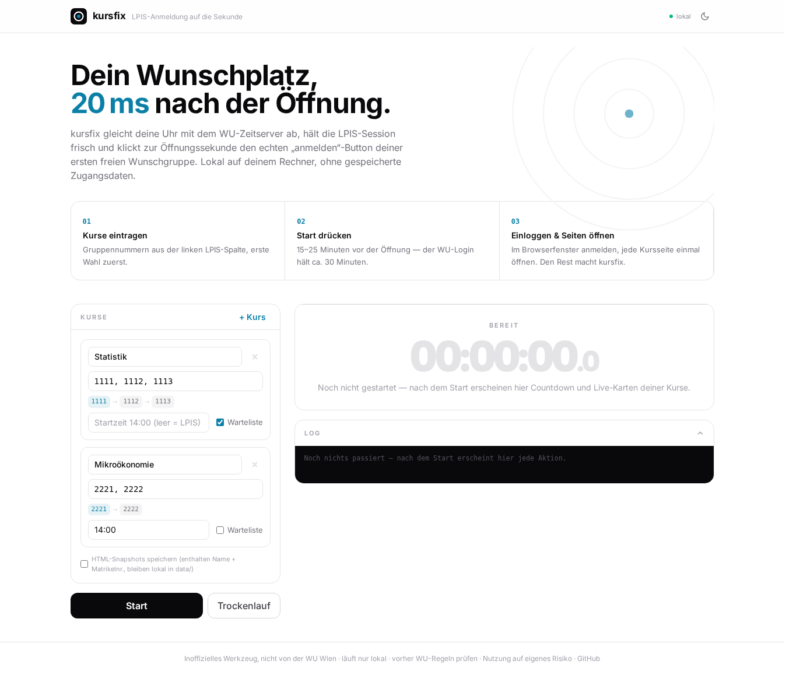

# kursfix

Lokale Web-App, die dich im WU-Wien-LPIS auf die Sekunde genau für Kurse
anmeldet — mehrere Kurse gleichzeitig, jeder mit eigener Gruppen-Wunschliste.
Läuft nur auf deinem Rechner, nichts wird gehostet; Login machst du selbst im
echten Browserfenster (WU-SSO), **Zugangsdaten werden nie abgefragt oder
gespeichert**.

Inspiriert von [discreteagent/wu-lpis-bot](https://github.com/discreteagent/wu-lpis-bot)
(im WiSe 2026 live getestet); die Logik wurde für diese App neu geschrieben.


<details>
<summary>Mehr Screenshots (Startansicht, Dark Mode)</summary>



</details>

## Setup

Voraussetzungen: Python 3.10+, Node.js (nur für den ersten Start, baut die UI),
Google Chrome oder Microsoft Edge (sonst wird Chromium genutzt).

```bash
python -m venv .venv && source .venv/bin/activate   # Windows: .venv\Scripts\activate
pip install -r requirements.txt
playwright install chromium
python run.py
```

`run.py` baut beim ersten Mal das Frontend und öffnet <http://127.0.0.1:8237>.
(Kein Docker: die App muss ein sichtbares Browserfenster für den SSO-Login
öffnen können.)

## Bedienung

1. Kurse eintragen: pro Kurs die 4-stelligen Gruppennummern aus der linken
   LPIS-Spalte, **erste Wahl zuerst**. Optional eine manuelle Startzeit (falls
   LPIS keine anzeigt) und ob bei vollen Gruppen die Warteliste genommen werden
   soll. Alles wird lokal in `data/config.json` gespeichert.
2. **Start** drücken — **15–25 Minuten vor der Öffnung**, denn die WU verlangt
   nach ca. 30 Minuten einen frischen Login.
3. Im geöffneten Browserfenster einloggen und jede Kursseite (die mit den
   „anmelden“-Buttons) einmal öffnen. Die App übernimmt sie in eigene Tabs,
   zeigt Gruppen, freie Plätze und Öffnungszeit live an und meldet `ARMED`.
4. Fenster in Ruhe lassen. Die App hält die Session mit Reloads frisch, gleicht
   die Uhr gegen `timeserver.wu.ac.at` und die LPIS-Serverzeit ab (Offset und
   Latenz stehen im Header) und synchronisiert kurz vor der Öffnung erneut.
5. Zur Öffnung lädt sie neu und klickt den echten „anmelden“-Button der ersten
   freien Gruppe deiner Liste (max. 3 Versuche pro Gruppe, schnelle Retries nur
   in den ersten 2 Sekunden). Erfolg = der Button wird „abmelden“; das Ergebnis
   steht auf der Kurskarte. Danach in der LPIS-Anmeldeliste gegenprüfen.

## Wie kursfix entscheidet

**Priorität:** Zur Öffnung wird die Seite neu geladen und die **erste Gruppe
deiner Liste geklickt, die offen ist und freie Plätze zeigt**. Registriert der
Klick nicht (LPIS-Hänger, Platz im selben Moment weg), wird neu geladen und
erneut geprüft — maximal 3 Versuche pro Gruppe; schnelle Wiederholungen
(alle 0,15 s) gibt es nur in den ersten 2 Sekunden, danach wird abgebremst.

**Warteliste (pro Kurs einstellbar):** Sie greift nur, wenn *alle* deine
Gruppen 0 freie Plätze zeigen.

| Einstellung | Verhalten, wenn alles voll ist |
|---|---|
| **an** (Standard) | kursfix trägt dich in die Warteliste deiner **ersten Wahl** ein und zeigt danach die freien Plätze der anderen Gruppen, falls du lieber von Hand wechselst. |
| **aus** | Es wird keine volle Gruppe angeklickt. kursfix beobachtet 2 Minuten weiter — meldet sich jemand ab, schlägt es sofort zu. Danach gibt es auf. Sinnvoll, wenn dir ein Wartelistenplatz nichts bringt. |

**Startzeit:** Normalerweise liest kursfix den Öffnungszeitpunkt („ab 28.09.
14:00“) von der Kursseite. Nur wenn dort keiner steht, trägst du ihn manuell
ein — `14:00`, `14:00:00` oder `28.09.2026 14:00` (Wiener Zeit). Eine gesetzte
Startzeit hat immer Vorrang. **Alle Gruppen eines Kurses gehören in einen
Eintrag** — verteilt auf zwei Einträge stoppt kursfix mit einer Erklärung,
damit sich die Tabs nicht gegenseitig in die Quere kommen.

**Schon angemeldet?** Zeigt eine Gruppe bereits „abmelden“, überspringt kursfix
den Kurs (es wird nie abgemeldet oder umgemeldet).

## Wenn etwas schiefgeht

| Meldung | Bedeutung / was tun |
|---|---|
| Banner „ausgeloggt“ + Ton | WU-Session abgelaufen. Im Bot-Fenster neu einloggen, Kursseite wieder öffnen — kursfix macht alleine weiter. |
| `nicht auf der Seite — Nummer prüfen` | Die Gruppennummer steht nicht auf der geöffneten Kursseite. Tippfehler oder falscher Kurs. |
| `kein Button gefunden` | LPIS hat sein Seitenlayout geändert — nicht auf kursfix verlassen, von Hand anmelden. |
| `WARTELISTE` (gold) | Die Gruppe war im Klickmoment voll. Die Karte zeigt die freien Plätze der anderen Gruppen zum manuellen Wechseln. |
| `Anmeldung hat nie geöffnet` | 30 s nach der (vermuteten) Öffnung weiter alles gesperrt — Öffnungszeit und Nummern prüfen. |
| `aufgegeben` | 2 Minuten nach Öffnung ohne Erfolg — in LPIS von Hand prüfen. |

## Trockenlauf

Der Button **Trockenlauf** startet einen lokalen Fake-LPIS mit genau deinen
Kursen (Öffnung nach 60 s) und spielt den Ablauf komplett durch — Login-Klick,
Kursseiten öffnen, Countdown, Anmeldung. Es verlässt kein Request deinen
Rechner.

## Prüflauf

Der Button **Prüflauf** geht gegen das **echte** LPIS, klickt aber garantiert
nichts: einloggen, Kursseiten öffnen — kursfix liest Gruppen, freie Plätze,
Buttons und Öffnungszeit, gleicht die Uhr ab und meldet pro Kurs `geprüft` oder
das Problem (Nummer nicht auf der Seite, kein Button, keine Öffnungszeit,
Anmeldung bereits offen). So siehst du vor der Öffnung, ob kursfix die echte
Seite richtig versteht. Den Klick selbst kann nur der echte Lauf zeigen.

**Echt oder Fake?** Während jedes Laufs steht der Modus unter den Buttons:
`ECHTES LPIS` (rot, es wird wirklich angemeldet), `PRÜFLAUF` (gold) oder
`TROCKENLAUF` (lokaler Fake). Die erste Logzeile nennt das Ziel, und die
Adresszeile im Bot-Fenster zeigt `lpis.wu.ac.at` bzw. `127.0.0.1`.

## Tests

```bash
pytest
```

Läuft headless gegen den Fake-LPIS (`fakelpis/`): Prioritätsfolge bei vollen
Gruppen, Warteliste an/aus, Retries nach Fehlklicks, Logout-Erkennung samt
Re-Login. An das echte LPIS wird dabei nie ein Request gesendet.

## Hinweise

- Die App geht bewusst sanft mit LPIS um: eine Session, ein Seitenaufruf pro
  Versuch, Keepalive nur alle 2 Minuten.
- Das Timing läuft auf der Rohuhr des Kernels, nicht auf der Systemuhr: Eine
  Systemuhr, die springt oder falsch geht (in WSL2 gemessen: 8 % zu langsam,
  alle 35 s um 3 s nachgestellt), verschiebt den Klick damit nicht. Der
  Prüflauf misst die Uhr zweimal und warnt, falls sie trotzdem instabil ist.
- HTML-Snapshots der gesehenen Seiten (enthalten Name und Matrikelnummer) werden
  nur geschrieben, wenn du es in der UI aktivierst; `data/` ist git-ignoriert.
- **Inoffiziell und nicht von der WU.** Prüfe vorher, ob die WU-Regeln
  automatisierte Anmeldung erlauben. Nutzung auf eigenes Konto und eigenes
  Risiko.
