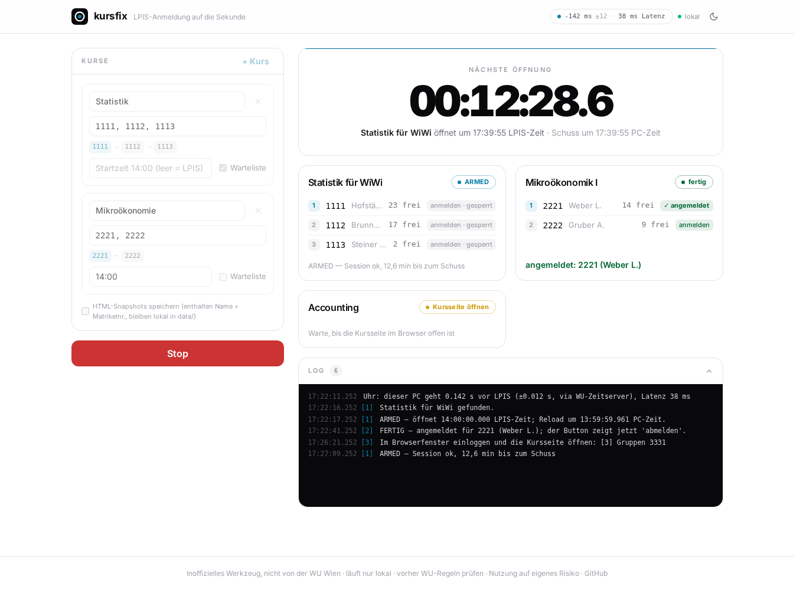
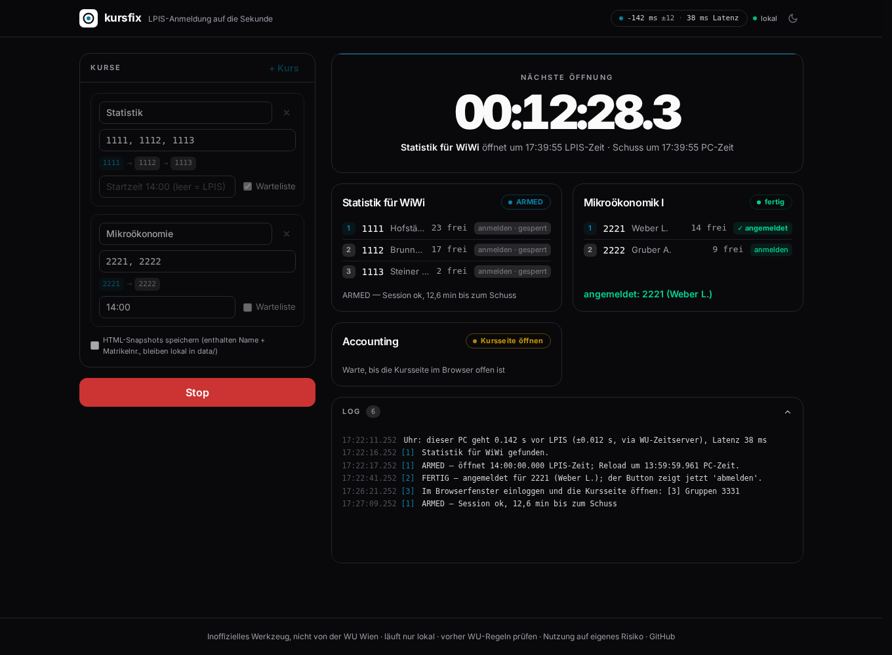

# kursfix

Lokale Web-App, die dich im WU-Wien-LPIS auf die Sekunde genau für Kurse
anmeldet — mehrere Kurse gleichzeitig, jeder mit eigener Gruppen-Wunschliste.
Läuft nur auf deinem Rechner, nichts wird gehostet; Login machst du selbst im
echten Browserfenster (WU-SSO), **Zugangsdaten werden nie abgefragt oder
gespeichert**.

Inspiriert von [discreteagent/wu-lpis-bot](https://github.com/discreteagent/wu-lpis-bot)
(im WiSe 2026 live getestet); die Logik wurde für diese App neu geschrieben.



<details>
<summary>Mehr Screenshots (Startansicht, Dark Mode)</summary>



</details>

## Setup

Voraussetzungen: Python 3.10+, Node.js (nur für den ersten Start, baut die UI),
Google Chrome oder Microsoft Edge (sonst wird Chromium genutzt).

```bash
python -m venv .venv && source .venv/bin/activate   # Windows: .venv\Scripts\activate
pip install -r requirements.txt
playwright install chromium
python run.py
```

`run.py` baut beim ersten Mal das Frontend und öffnet <http://127.0.0.1:8237>.
(Kein Docker: die App muss ein sichtbares Browserfenster für den SSO-Login
öffnen können.)

## Bedienung

1. Kurse eintragen: pro Kurs die 4-stelligen Gruppennummern aus der linken
   LPIS-Spalte, **erste Wahl zuerst**. Optional eine manuelle Startzeit (falls
   LPIS keine anzeigt) und ob bei vollen Gruppen die Warteliste genommen werden
   soll. Alles wird lokal in `data/config.json` gespeichert.
2. **Start** drücken — **15–25 Minuten vor der Öffnung**, denn die WU verlangt
   nach ca. 30 Minuten einen frischen Login.
3. Im geöffneten Browserfenster einloggen und jede Kursseite (die mit den
   „anmelden“-Buttons) einmal öffnen. Die App übernimmt sie in eigene Tabs,
   zeigt Gruppen, freie Plätze und Öffnungszeit live an und meldet `ARMED`.
4. Fenster in Ruhe lassen. Die App hält die Session mit Reloads frisch, gleicht
   die Uhr gegen `timeserver.wu.ac.at` und die LPIS-Serverzeit ab (Offset und
   Latenz stehen im Header) und synchronisiert kurz vor der Öffnung erneut.
5. Zur Öffnung lädt sie neu und klickt den echten „anmelden“-Button der ersten
   freien Gruppe deiner Liste (max. 3 Versuche pro Gruppe, schnelle Retries nur
   in den ersten 2 Sekunden). Erfolg = der Button wird „abmelden“; das Ergebnis
   steht auf der Kurskarte. Danach in der LPIS-Anmeldeliste gegenprüfen.

Wirst du zwischendurch ausgeloggt, warnt die App (Banner + Ton): im
Bot-Fenster neu einloggen und die Kursseite wieder öffnen — sie macht alleine
weiter. Meldet sie „kein Button gefunden“, hat LPIS sein Layout geändert:
dann nicht auf die App verlassen.

## Trockenlauf

Der Button **Trockenlauf** startet einen lokalen Fake-LPIS mit genau deinen
Kursen (Öffnung nach 60 s) und spielt den Ablauf komplett durch — Login-Klick,
Kursseiten öffnen, Countdown, Anmeldung. Es verlässt kein Request deinen
Rechner.

## Tests

```bash
pytest
```

Läuft headless gegen den Fake-LPIS (`fakelpis/`): Prioritätsfolge bei vollen
Gruppen, Warteliste an/aus, Retries nach Fehlklicks, Logout-Erkennung samt
Re-Login. An das echte LPIS wird dabei nie ein Request gesendet.

## Hinweise

- Die App geht bewusst sanft mit LPIS um: eine Session, ein Seitenaufruf pro
  Versuch, Keepalive nur alle 2 Minuten.
- HTML-Snapshots der gesehenen Seiten (enthalten Name und Matrikelnummer) werden
  nur geschrieben, wenn du es in der UI aktivierst; `data/` ist git-ignoriert.
- **Inoffiziell und nicht von der WU.** Prüfe vorher, ob die WU-Regeln
  automatisierte Anmeldung erlauben. Nutzung auf eigenes Konto und eigenes
  Risiko.
